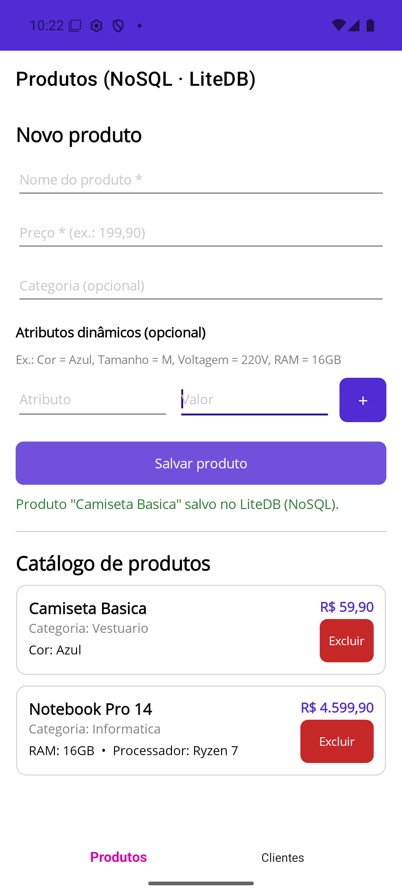
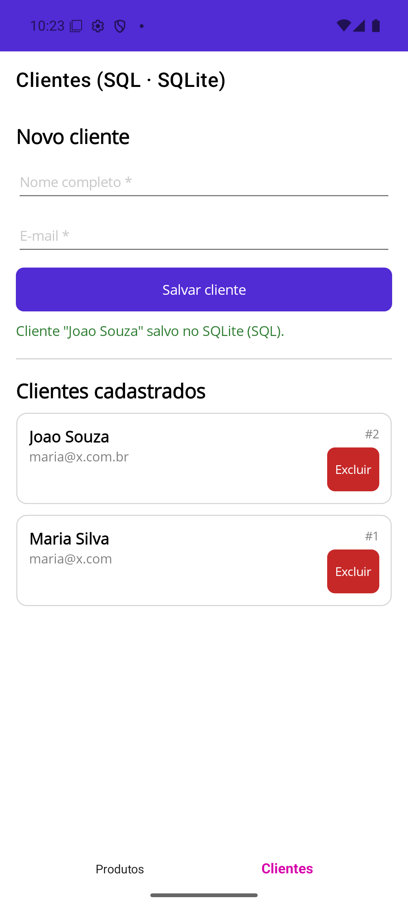

# EasyShop: Persistência Poliglota com .NET MAUI

Este é um protótipo de mini e-commerce que usa **dois paradigmas de banco de dados locais ao mesmo tempo** no mesmo app Android:

| Domínio | Paradigma | Tecnologia | Por quê |
|---|---|---|---|
| **Catálogo de Produtos** | NoSQL (documentos) | [LiteDB](https://www.litedb.org/) 5 | Cada produto pode ter atributos diferentes (cor, tamanho, voltagem, RAM...). Eles ficam num sub-documento BSON, sem alterar schema. |
| **Cadastro de Clientes** | SQL (relacional) | SQLite via [sqlite-net-pcl](https://github.com/praeclarum/sqlite-net) | Dados estruturados com schema fixo e restrições aplicadas pelo banco (`PRIMARY KEY`, `NOT NULL`, `UNIQUE`). |

## 👥 Integrantes

- _Luis Antônio Gambogi Ferreira Neto_
- _Yago Cesar Chagas Lima_

## 🎬 Vídeo de demonstração

_[Link do YouTube](https://www.youtube.com/shorts/ljdT_ehWVUo)_

## 📸 Telas

| Produtos (LiteDB) | Clientes (SQLite) |
|---|---|
|  |  |

## 🏛️ Arquitetura em camadas

```
src/EasyShop/
├── Views/            ← Apresentação: páginas XAML (sem acesso a banco)
├── ViewModels/       ← Apresentação: estado da tela e comandos (MVVM)
├── Services/         ← Negócio: validações e orquestração
├── Data/             ← Acesso a dados: repositórios (um por banco)
│   ├── LiteDbProductRepository.cs    (NoSQL)
│   └── SqliteCustomerRepository.cs   (SQL)
└── Models/           ← Entidades: Product (documento) e Customer (tabela)
```

Fluxo de uma operação: `View → ViewModel → Service → IRepository → Banco`

- **Apresentação:** `ProductsPage`/`CustomersPage` só fazem binding com os ViewModels. Os ViewModels convertem a entrada do usuário (ex.: preço digitado) e exibem mensagens, sem conhecer nenhum banco.
- **Negócio:** `ProductService` exige nome, preço maior que zero e atributos com chave e valor. `CustomerService` exige nome completo (nome e sobrenome), e-mail válido e e-mail único, que é normalizado para minúsculas.
- **Acesso a dados:** as interfaces `IProductRepository` e `ICustomerRepository` isolam o banco. Trocar o LiteDB por outro banco de documentos, por exemplo, só afeta a camada `Data`.
- As dependências são registradas por injeção de dependência em `MauiProgram.cs`.

### Como fica cada dado armazenado

**NoSQL** (`products.db`, coleção `products`): cada produto tem um formato próprio.
```json
{ "_id": 1, "Name": "Notebook Pro 14", "Price": 4599.90, "Category": "Informatica",
  "Attributes": { "RAM": "16GB", "Processador": "Ryzen 7" } }
{ "_id": 2, "Name": "Camiseta Basica", "Price": 59.90, "Category": "Vestuario",
  "Attributes": { "Cor": "Azul", "Tamanho": "M" } }
```

**SQL** (`customers.db3`): a tabela é gerada a partir da classe `Customer`.
```sql
CREATE TABLE customers (
  Id INTEGER PRIMARY KEY AUTOINCREMENT,
  Name VARCHAR(150) NOT NULL,
  Email VARCHAR(150) NOT NULL UNIQUE,
  CreatedAt BIGINT NOT NULL
);
```

Os dois arquivos ficam em `FileSystem.AppDataDirectory`, no armazenamento privado do app.

## ▶️ Como executar

### Pré-requisitos
- [.NET SDK 10](https://dotnet.microsoft.com/download)
- Workload MAUI: `dotnet workload install maui-android`
- Android SDK com um emulador (AVD) configurado, por exemplo pelo Visual Studio 2026 ou pelo Android Studio

### Visual Studio
1. Abra `EasyShop.sln`.
2. Selecione o framework **net10.0-android** e o emulador desejado.
3. Pressione **F5**.

### Linha de comando
Com o emulador já aberto:
```bash
cd src/EasyShop
dotnet build -t:Run -f net10.0-android
```

## 📦 Pacotes NuGet

| Pacote | Uso |
|---|---|
| `LiteDB` | Banco NoSQL de documentos embarcado |
| `sqlite-net-pcl` | ORM leve e conexão com o SQLite |
| `CommunityToolkit.Mvvm` | `ObservableObject`, `[ObservableProperty]` e `[RelayCommand]` |

> **Observação sobre o `SQLitePCLRaw.bundle_green`:** o enunciado sugere esse pacote, mas a versão atual do `sqlite-net-pcl` (1.11.x) já traz o SQLitePCLRaw 3.x com a biblioteca nativa do SQLite. O `bundle_green` só existe na versão 2.1.x. Com ele, o NuGet rebaixava o `SQLitePCLRaw.core` para 2.1.11, o que gera conflito de versão e traz uma dependência com vulnerabilidade conhecida (GHSA-2m69-gcr7-jv3q). Por isso ele não foi incluído.

## ✅ Funcionalidades

- **Aba Produtos:** cadastro com nome, preço, categoria opcional e quantos atributos dinâmicos o usuário quiser. A listagem é lida do LiteDB e cada item pode ser excluído.
- **Aba Clientes:** cadastro com nome completo e e-mail, com validação. A listagem é lida do SQLite e cada item pode ser excluído.
- Os dados continuam salvos depois de fechar e reabrir o app.
- Valores aparecem no padrão brasileiro (R$ 4.599,90). O campo de preço aceita vírgula ou ponto em qualquer idioma do emulador.
